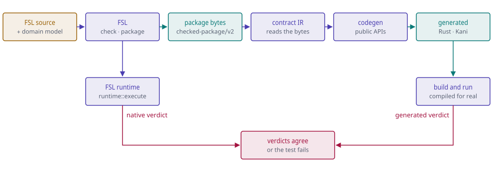
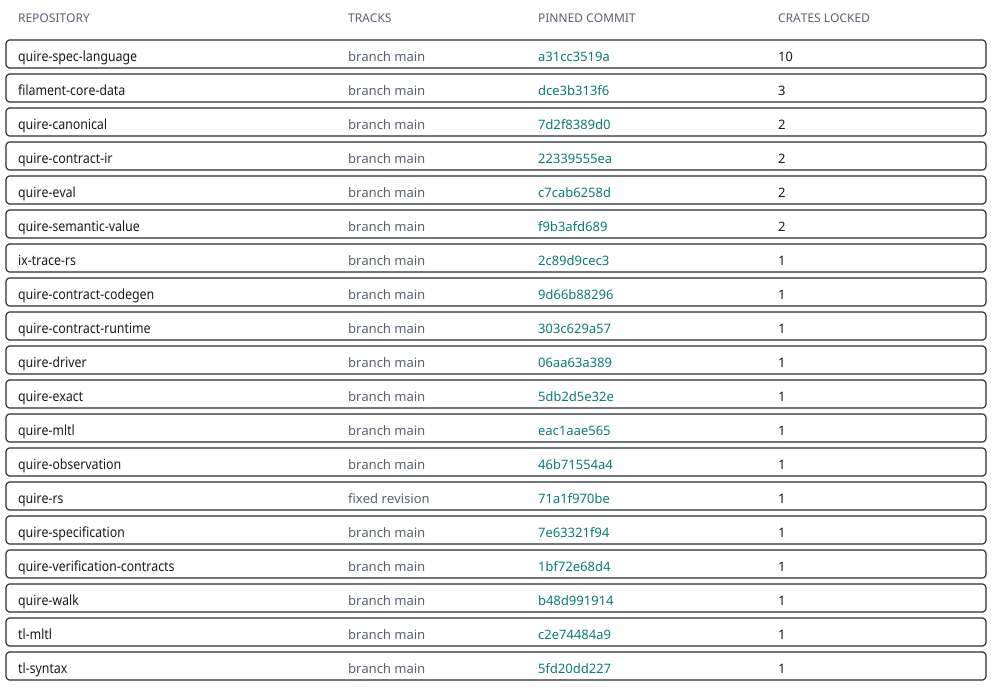

# filament-integration

[](https://discord.gg/k8DVhuYBR2)
[](https://github.com/agent-ix/filament-spec-language)

filament-integration is the cross-repository integration test crate for the Filament
toolchain. It checks that the stages, each in its own repository, agree on the
bytes they pass to each other.

It pins every stage to an exact commit in one `Cargo.lock`. Its tests admit
checked FSL packages through Contract IR, pass supported scalar operations to
the code generator, compare generated native results with FSL's own runtime,
and run real proof and native paths.

<picture>
  <source media="(prefers-color-scheme: dark)" srcset="docs/images/hero-dark.svg">
  
</picture>

## Getting started

The crate is not published. Clone it and run the tests:

```bash
git clone https://github.com/agent-ix/filament-integration
cd filament-integration
cargo test
```

The Rust toolchain named in `rust-toolchain.toml` installs itself on first use.
The Kani proof tests need an installed Kani and CBMC; the other tests need
nothing else.

## Tests

Each integration test file composes real producer and consumer APIs from the
locked repositories. The main groups:

| Group | Path it exercises |
| --- | --- |
| Bound export | FSL compilation, the driver's per-item binding export, code generation, and a real Kani scalar proof whose arithmetic mutant falsifies |
| Model owner admission | A FSL unit emitted as `checked-package/v2` bytes, read by Contract IR and passed to the code generator's scalar claim API |
| Generated oracle | Generated native operations compared with the original FSL bodies on results, locations, losses, charges and counters |
| Producer origin | Runtime identities originate in FSL source admitted by Contract IR |
| Monitor program | Runtime monitor program construction from identities of a live FSL producer, including adverse inputs |
| Temporal formula and observation revision | Instance-bound checked subjects become TL owner formulas, and historical observation bundles are admitted with exact membership and revision |

The plain-language description of each scenario is in `spec/integration/`, one
file per scenario with its objective, preconditions, procedure and expected
result.

### Example

The model-owner tests supply a domain document under `foreign/orders` while the
emitted unit selects `acme/orders`. Contract IR refuses the missing selected
import with `MissingImport`, locating it at the model-root owner's identity.

## Version lock

The lock is `Cargo.lock`. `Cargo.toml` names each first-party repository by
branch `main`, and the lock fixes that branch to one commit, so all the crates
of a repository resolve to the same revision. FSL's lowering and the code
generator share one set of Contract IR types. The table is generated from the
lock file.

<picture>
  <source media="(prefers-color-scheme: dark)" srcset="docs/images/lock-dark.svg">
  
</picture>

To move the lock, run `cargo update -p <crate>` for the repository you want and
commit the new `Cargo.lock` together with a passing test run.

## Quire ecosystem

<picture>
  <source media="(prefers-color-scheme: dark)" srcset="docs/images/ecosystem-dark.svg">
  
</picture>

## Building and testing

```bash
make fmt-check    # rustfmt
make lint         # clippy, warnings are errors
make test         # cargo test
make kani         # real Kani proof and mutation
make build        # release build
make deny         # license check
make audit-unsafe # Clippy unsafe-block documentation gate
make ci           # all of the gates
```

## Contributing and license

Contributions need a signed Contributor License Agreement; see
[CONTRIBUTING.md](CONTRIBUTING.md) and [CLA.md](CLA.md). Original content is
licensed under `AGPL-3.0-or-later`; see [LICENSE](LICENSE).
